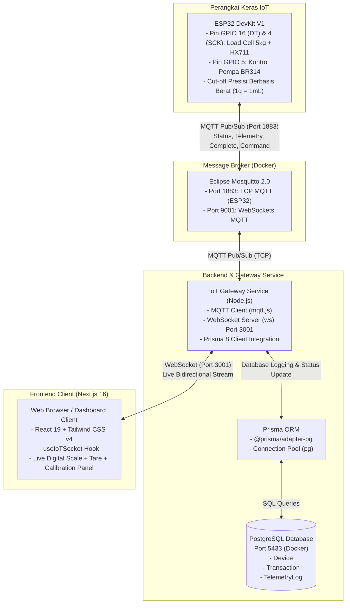
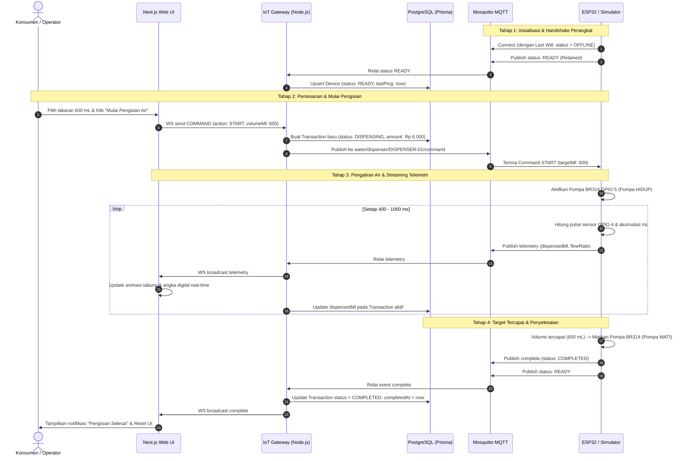

# Arsitektur Sistem: Project Air Minum Otomatis Berbayar (WaterVend IoT)

Dokumen ini menjelaskan arsitektur perangkat lunak, perangkat keras, topologi jaringan, struktur direktori proyek, dan alur komunikasi data untuk **Project Air Minum Otomatis Berbayar** (versi 0.1.0 Core IoT & Deployment).

---

## 1. High-Level System Architecture

Sistem ini dirancang menggunakan arsitektur modular terdistribusi yang menggabungkan perangkat keras mikrokontroler (ESP32), broker pesan berkinerja tinggi (Eclipse Mosquitto), gateway perantara WebSocket (Node.js), antarmuka web modern (Next.js 16 App Router), serta basis data relasional (PostgreSQL via Prisma ORM).



---

## 2. Struktur Direktori Proyek

Struktur folder dan file di dalam repositori ini disusun secara modular:

```
project-air-minum-otomatis-berbayar/
├── app/                             # Next.js 16 App Router
│   ├── favicon.ico
│   ├── globals.css                  # Konfigurasi Tailwind CSS v4
│   ├── layout.tsx                   # Root layout Next.js
│   └── page.tsx                     # Dashboard utama pemantauan, timbangan & kontrol dispenser
├── docs/                            # Dokumentasi teknis proyek
│   ├── ARCHITECTURE.md              # Arsitektur sistem & alur komunikasi
│   ├── ERD.md                       # Entity Relationship Diagram & kamus data
│   └── PRD.md                       # Product Requirements Document (v0.1.0)
├── firmware/                        # Kode perangkat keras fisik
│   ├── esp32_dispenser.ino          # Firmware utama Arduino C++ ESP32 (HX711 & Relay)
│   └── calibration_hx711.ino        # Skrip kalibrasi mandiri timbangan via Serial Monitor
├── lib/                             # Shared utility & client hooks
│   ├── prisma.ts                    # Singleton Prisma Client dengan adapter pg Pool
│   └── use-iot-socket.ts            # Custom React hook untuk koneksi WebSocket
├── mosquitto/                       # Konfigurasi Message Broker
│   └── config/
│       └── mosquitto.conf           # Konfigurasi listener port 1883 & 9001 Mosquitto
├── prisma/                          # Skema basis data
│   └── schema.prisma                # Definisi model Device, Transaction, TelemetryLog
├── server/                          # Backend services
│   └── iot-bridge.ts                # IoT Gateway (MQTT <-> WebSocket & Prisma DB)
├── .dockerignore                    # Aturan pengecualian Docker build
├── .env                             # Environment variables lokal aktif
├── .env.example                     # Contoh template environment variables
├── docker-compose.yml               # Orkestrasi multi-container Mosquitto, PostgreSQL, IoT Bridge, Web
├── Dockerfile                       # Multi-stage build container Next.js Web App
├── Dockerfile.bridge                # Container build untuk IoT Gateway Service
├── package.json                     # Konfigurasi dependencies dan scripts eksekusi
├── prisma.config.ts                 # Konfigurasi datasource URL Prisma
└── tsconfig.json                    # Konfigurasi compiler TypeScript
```

---

## 3. Protokol & Topologi Komunikasi

### 3.1. Alokasi Port Jaringan
| Layanan | Port Host | Port Kontainer | Protokol | Keterangan |
| :--- | :--- | :--- | :--- | :--- |
| **Mosquitto MQTT** | `1883` | `1883` | TCP / MQTT | Komunikasi standar ESP32 & IoT Gateway |
| **Mosquitto WS** | `9001` | `9001` | WebSocket | Listener MQTT via browser (opsional) |
| **PostgreSQL** | `5433` | `5432` | TCP / SQL | Database utama (dimapping ke 5433 agar tidak bentrok dengan Postgres lokal) |
| **IoT WS Gateway** | `3001` | - | WebSocket | Gateway bidirectional browser web |
| **Next.js Web** | `3000` | - | HTTP / SSR | Antarmuka web dashboard aplikasi |

---

### 3.2. Spesifikasi Topik MQTT (Pub/Sub)

Semua topik menggunakan namespace `water/dispenser/{deviceId}/...`:

| Topik MQTT | Arah Pesan | Publisher | Subscriber | Deskripsi Payload |
| :--- | :--- | :--- | :--- | :--- |
| `water/dispenser/{deviceId}/status` | Outbound | ESP32 | IoT Bridge | Status koneksi (`{"status":"READY"}` atau `{"status":"OFFLINE"}`) via LWT |
| `water/dispenser/{deviceId}/command` | Inbound | IoT Bridge | ESP32 | Instruksi aksi (`{"action":"START","volumeMl":600,"transactionId":"..."}`) |
| `water/dispenser/{deviceId}/telemetry` | Outbound | ESP32 | IoT Bridge | Data sensor berkala (`{"flowRate":1.5,"dispensedMl":240,"status":"DISPENSING"}`) |
| `water/dispenser/{deviceId}/complete` | Outbound | ESP32 | IoT Bridge | Konfirmasi pengisian selesai (`{"status":"COMPLETED","dispensedMl":600}`) |

---

### 3.3. Spesifikasi Payload WebSocket (`ws://localhost:3001`)

1. **Client Connect Handshake (`SYSTEM_STATUS`)**:
   Dikirim oleh server saat browser pertama kali terhubung:
   ```json
   {
     "type": "SYSTEM_STATUS",
     "mqttConnected": true,
     "wsConnected": true,
     "timestamp": "2026-10-11T02:00:00.000Z"
   }
   ```

2. **Event Relai Telemetri (`MQTT_EVENT`)**:
   Diteruskan ke browser setiap kali ESP32 mengirim telemetri:
   ```json
   {
     "type": "MQTT_EVENT",
     "topic": "water/dispenser/DISPENSER-01/telemetry",
     "deviceCode": "DISPENSER-01",
     "eventType": "telemetry",
     "data": {
       "deviceId": "DISPENSER-01",
       "status": "DISPENSING",
       "flowRate": 1.25,
       "dispensedMl": 350,
       "targetMl": 600,
       "transactionId": "tx-1728612345"
     },
     "timestamp": "2026-10-11T02:00:01.000Z"
   }
   ```

3. **Perintah Kontrol dari Web (`COMMAND`)**:
   Dikirim oleh browser saat tombol ditekan:
   ```json
   {
     "type": "COMMAND",
     "deviceId": "DISPENSER-01",
     "action": "START",
     "volumeMl": 600
   }
   ```

---

## 4. Sequence Diagram: Alur Pengisian Air End-to-End

Berikut adalah alur lengkap siklus pengisian air minum dari antarmuka pengguna hingga perangkat keras ESP32:



---

## 5. Keamanan & Mekanisme Fail-Safe

1. **Kontrol Aktuator Pompa BR314 (Normally-Off)**:
   Pompa air BR314 dikendalikan melalui relai atau modul driver MOSFET dengan kondisi default mati (*Normally Off*). Apabila terjadi kehilangan daya listrik pada ESP32 atau sistem terhenti, pompa otomatis mati dan tidak ada air yang dialirkan, mencegah terjadinya tumpahan air (*overflow*).
2. **MQTT Last Will and Testament (LWT)**:
   Saat ESP32 membuat koneksi MQTT, ia mendaftarkan pesan LWT pada topik `status`. Jika koneksi terputus tanpa pesan disconnect formal (misal ESP32 mati/kehilangan sinyal), Mosquitto akan langsung mempublikasikan status `OFFLINE` sehingga gateway dan UI web langsung mengetahui kondisi tersebut.
3. **Dual Cutoff Logic**:
   Pemutusan aliran air dilakukan terutama oleh loop internal ESP32 secara otonom saat `totalMilliLitres >= targetMilliLitres` tanpa bergantung pada koneksi internet. Tombol "Stop Darurat" pada web UI bertindak sebagai proteksi sekunder melalui perintah MQTT `STOP`.
4. **Auto-Reconnect Resiliency**:
   - ESP32 memiliki loop pengecekan koneksi MQTT dan Wi-Fi setiap siklus.
   - IoT Bridge memiliki event handler `reconnect` otomatis ke broker Mosquitto.
   - Hook React `useIoTSocket` secara otomatis mencoba menyambung kembali (`auto-reconnect`) setiap 3 detik jika koneksi WebSocket terputus.
