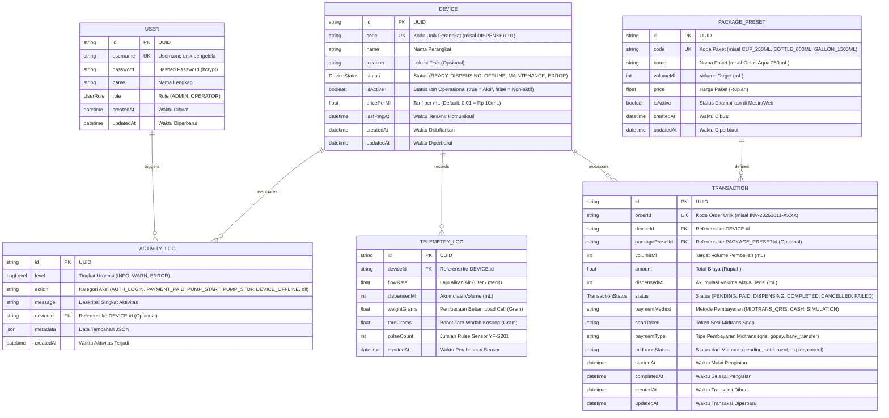
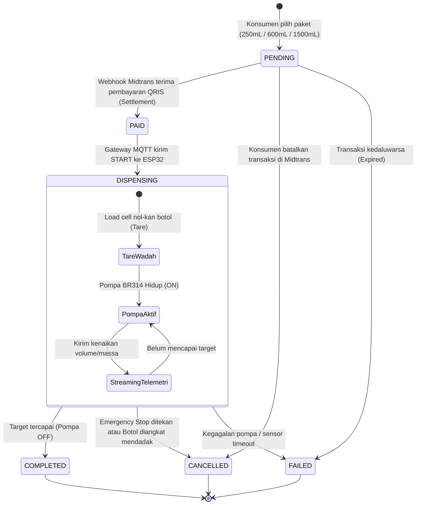

# Entity Relationship Diagram (ERD): Project Air Minum Otomatis Berbayar

Dokumen ini menjelaskan struktur basis data relasional PostgreSQL yang dikelola melalui Prisma ORM untuk **Project Air Minum Otomatis Berbayar (WaterVend IoT)** versi **0.2.0** (Database, Autentikasi Admin, Midtrans Payment Gateway, Realtime Dashboard, Activity Logs, & Device Management).

---

## 1. Visual Entity Relationship Diagram

Diagram relasi entitas berikut memetakan relasi antar tabel dalam basis data:

---

## 2. Kamus Data (Data Dictionary)

### 2.1. Entitas: `User`
Tabel kredensial autentikasi untuk pengelola sistem (Admin / Operator).

| Kolom | Tipe Data PostgreSQL | Tipe Prisma | Atribut | Keterangan |
| :--- | :--- | :--- | :--- | :--- |
| `id` | `VARCHAR(36)` | `String` | `@id`, `@default(uuid())` | Primary key UUID. |
| `username` | `VARCHAR(50)` | `String` | `@unique` | Username untuk login. |
| `password` | `VARCHAR(255)` | `String` | - | Hash password (bcrypt). |
| `name` | `VARCHAR(100)` | `String?` | Opsional | Nama pengelola. |
| `role` | `ENUM` | `UserRole` | `@default(ADMIN)` | Level akses (`ADMIN`, `OPERATOR`). |
| `createdAt` | `TIMESTAMP(3)` | `DateTime` | `@default(now())` | Waktu akun dibuat. |
| `updatedAt` | `TIMESTAMP(3)` | `DateTime` | `@updatedAt` | Waktu akun diperbarui. |

---

### 2.2. Entitas: `Device`
Tabel unit dispenser ESP32 yang terhubung ke sistem.

| Kolom | Tipe Data PostgreSQL | Tipe Prisma | Atribut | Keterangan |
| :--- | :--- | :--- | :--- | :--- |
| `id` | `VARCHAR(36)` | `String` | `@id`, `@default(uuid())` | Primary key UUID. |
| `code` | `VARCHAR(50)` | `String` | `@unique` | Kode unik perangkat (e.g. `DISPENSER-01`). |
| `name` | `VARCHAR(100)` | `String` | - | Nama representatif unit dispenser. |
| `location` | `VARCHAR(255)` | `String?` | Opsional | Lokasi penempatan fisik mesin. |
| `status` | `ENUM` | `DeviceStatus` | `@default(READY)` | Status realtime perangkat. |
| `isActive` | `BOOLEAN` | `Boolean` | `@default(true)` | Sakelar izin operasi (Bisa dimatikan remote oleh admin). |
| `pricePerMl` | `DOUBLE PRECISION` | `Float` | `@default(0.01)` | Tarif air per mL (Default Rp 10 / mL). |
| `lastPingAt` | `TIMESTAMP(3)` | `DateTime?` | Opsional | Waktu heartbeat/telemetri terakhir. |
| `createdAt` | `TIMESTAMP(3)` | `DateTime` | `@default(now())` | Waktu pendaftaran perangkat. |
| `updatedAt` | `TIMESTAMP(3)` | `DateTime` | `@updatedAt` | Waktu pembaruan data terakhir. |

---

### 2.3. Entitas: `PackagePreset`
Tabel preset pilihan paket volume pengisian air yang ditampilkan di Web Kiosk / Layar TFT.

| Kolom | Tipe Data PostgreSQL | Tipe Prisma | Atribut | Keterangan |
| :--- | :--- | :--- | :--- | :--- |
| `id` | `VARCHAR(36)` | `String` | `@id`, `@default(uuid())` | Primary key UUID. |
| `code` | `VARCHAR(50)` | `String` | `@unique` | Kode paket (`CUP_250ML`, `BOTTLE_600ML`, `GALLON_1500ML`). |
| `name` | `VARCHAR(100)` | `String` | - | Label nama paket (Gelas Aqua 250 mL). |
| `volumeMl` | `INTEGER` | `Int` | - | Besaran target volume (mL). |
| `price` | `DOUBLE PRECISION` | `Float` | - | Harga jual nominal (Rupiah). |
| `isActive` | `BOOLEAN` | `Boolean` | `@default(true)` | Status aktif apakah dapat dipilih konsumen. |
| `createdAt` | `TIMESTAMP(3)` | `DateTime` | `@default(now())` | Waktu dibuat. |
| `updatedAt` | `TIMESTAMP(3)` | `DateTime` | `@updatedAt` | Waktu diperbarui. |

---

### 2.4. Entitas: `Transaction`
Tabel pencatatan setiap pesanan pengisian air minum dan integrasi payment gateway.

| Kolom | Tipe Data PostgreSQL | Tipe Prisma | Atribut | Keterangan |
| :--- | :--- | :--- | :--- | :--- |
| `id` | `VARCHAR(36)` | `String` | `@id`, `@default(uuid())` | Primary key UUID internal. |
| `orderId` | `VARCHAR(100)` | `String` | `@unique` | Kode invoice unik Midtrans (e.g. `INV-WATER-1718000000`). |
| `deviceId` | `VARCHAR(36)` | `String` | `@relation` (FK) | Relasi ke `Device.id`. |
| `packagePresetId` | `VARCHAR(36)` | `String?` | `@relation` (FK) | Relasi ke `PackagePreset.id` (Opsional jika custom). |
| `volumeMl` | `INTEGER` | `Int` | - | Target volume pesanan (mL). |
| `amount` | `DOUBLE PRECISION` | `Float` | - | Total biaya transaksi (IDR). |
| `dispensedMl` | `INTEGER` | `Int` | `@default(0)` | Akumulasi volume terisi aktual (mL). |
| `status` | `ENUM` | `TransactionStatus` | `@default(PENDING)` | Tahapan status transaksi. |
| `paymentMethod` | `VARCHAR(50)` | `String` | `@default("MIDTRANS_QRIS")` | Metode pembayaran. |
| `snapToken` | `VARCHAR(255)` | `String?` | Opsional | Token transaksi Midtrans Snap. |
| `paymentType` | `VARCHAR(50)` | `String?` | Opsional | Jenis channel pembayaran (qris, gopay, dll). |
| `midtransStatus` | `VARCHAR(50)` | `String?` | Opsional | Status callback mentah dari Midtrans. |
| `startedAt` | `TIMESTAMP(3)` | `DateTime?` | Opsional | Waktu pompa mulai berputar. |
| `completedAt` | `TIMESTAMP(3)` | `DateTime?` | Opsional | Waktu pengisian selesai. |
| `createdAt` | `TIMESTAMP(3)` | `DateTime` | `@default(now())` | Waktu invoice dibuat. |
| `updatedAt` | `TIMESTAMP(3)` | `DateTime` | `@updatedAt` | Waktu pembaruan status terakhir. |

---

### 2.5. Entitas: `ActivityLog`
Tabel audit trail peristiwa sistem untuk pemantauan operasional dan debugging.

| Kolom | Tipe Data PostgreSQL | Tipe Prisma | Atribut | Keterangan |
| :--- | :--- | :--- | :--- | :--- |
| `id` | `VARCHAR(36)` | `String` | `@id`, `@default(uuid())` | Primary key UUID. |
| `level` | `ENUM` | `LogLevel` | `@default(INFO)` | Tingkat urgensi: `INFO`, `WARN`, `ERROR`. |
| `action` | `VARCHAR(100)` | `String` | - | Kode aksi (`AUTH_LOGIN`, `PAYMENT_PAID`, `PUMP_START`, dll). |
| `message` | `TEXT` | `String` | - | Deskripsi peristiwa manusiawi. |
| `deviceId` | `VARCHAR(36)` | `String?` | `@relation` (FK) | Perangkat terkait jika relevan. |
| `metadata` | `JSONB` | `Json?` | Opsional | Data konteks tambahan (payload, error stack, ip). |
| `createdAt` | `TIMESTAMP(3)` | `DateTime` | `@default(now())` | Waktu peristiwa terjadi. |

---

### 2.6. Entitas: `TelemetryLog`
Tabel riwayat sensor real-time (mendukung Flow Meter dan Load Cell timbangan).

| Kolom | Tipe Data PostgreSQL | Tipe Prisma | Atribut | Keterangan |
| :--- | :--- | :--- | :--- | :--- |
| `id` | `VARCHAR(36)` | `String` | `@id`, `@default(uuid())` | Primary key UUID. |
| `deviceId` | `VARCHAR(36)` | `String` | `@relation` (FK) | Relasi ke `Device.id`. |
| `flowRate` | `DOUBLE PRECISION` | `Float` | - | Laju aliran saat ini (L/min). |
| `dispensedMl` | `INTEGER` | `Int` | - | Akumulasi volume terisi (mL). |
| `weightGrams` | `DOUBLE PRECISION` | `Float?` | Opsional | Bobot terukur Load Cell saat ini (Gram). |
| `tareGrams` | `DOUBLE PRECISION` | `Float?` | Opsional | Bobot wadah kosong yang ditara (Gram). |
| `pulseCount` | `INTEGER` | `Int?` | Opsional | Pulse sensor flow YF-S201. |
| `createdAt` | `TIMESTAMP(3)` | `DateTime` | `@default(now())` | Waktu pencatatan. |

---

## 3. State Machine Transaksi (Terintegrasi Midtrans & Hardware)

