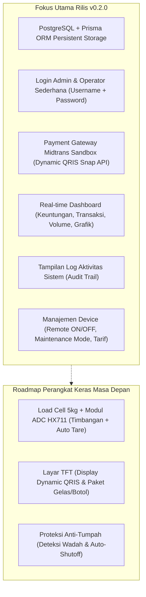
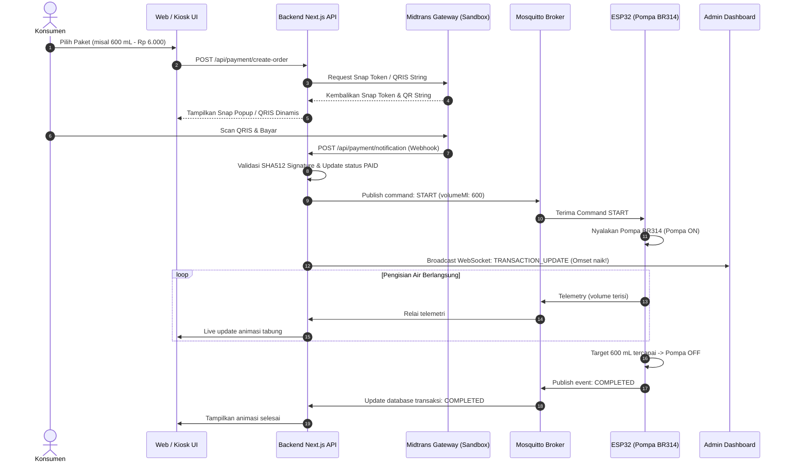

# Product Requirements Document (PRD)

| Metadata | Nilai |
| :--- | :--- |
| **Produk** | Project Air Minum Otomatis Berbayar (WaterVend IoT) |
| **Versi Dokumen** | 0.2.0 |
| **Fokus Utama Rilis** | Database Persistent, Autentikasi Admin, Payment Gateway Midtrans Sandbox, Real-time Analytics Dashboard, Log Aktivitas, Remote Device Management, & Roadmap Hardware Load Cell + TFT |
| **Status** | In Review / Approved |
| **Tanggal Pembaruan** | 11 Oktober 2026 |

---

## 1. Executive Summary & Problem Statement

### 1.1. Latar Belakang & Masalah
Pada rilis sebelumnya (v0.1.0), sistem telah berhasil menghubungkan antarmuka web, WebSocket gateway, Mosquitto MQTT, dan ESP32 untuk mengontrol Pompa BR314 secara real-time in-memory. Namun, untuk menjadikannya produk komersial yang mandiri dan siap operasional, sistem membutuhkan:
1. **Penyimpanan Data Persisten & Terstruktur**: Seluruh data transaksi, histori pengisian air, log telemetri, dan identitas perangkat harus tersimpan aman di database PostgreSQL.
2. **Sistem Autentikasi Pengelola (Admin/Operator)**: Diperlukan mekanisme login berbasis username dan password sederhana untuk melindungi data pendapatan bisnis, mengelola perangkat, dan memantau operasional.
3. **Gerbang Pembayaran Otomatis (Midtrans Sandbox)**: Konsumen harus dapat melakukan pembayaran non-tunai (terutama QRIS Dinamis) yang secara otomatis memicu pengaliran air tanpa intervensi manual kasir.
4. **Dashboard Pemantauan Keuntungan & Transaksi Real-time**: Pengelola dapat melihat omset harian, jumlah transaksi sukses, dan volume air yang terjual secara live.
5. **Log Aktivitas Komprehensif**: Audit trail peristiwa sistem (login, transaksi masuk, status pompa, anomali perangkat).
6. **Manajemen Kontrol Perangkat Jarak Jauh**: Kemampuan menghidupkan/mematikan mesin dispenser dan pompa manual dari dashboard pengelola.

### 1.2. Roadmap Inovasi Hardware Masa Depan
1. **Load Cell 5kg + HX711 (Pengukuran Berat Presisi & Fitur Tare)**: Menggantikan atau melengkapi flow sensor dengan timbangan digital berbasis massa ($1\text{ gram air} = 1\text{ mL}$). Sistem dapat menolkan wadah pengguna secara otomatis (*Tare*), mendeteksi keberadaan tumbler (*anti-spill*), dan memutus pompa seketika jika botol diangkat atau target volume tercapai.
2. **Layar TFT Terintegrasi (Dynamic QRIS & Pemilihan Paket)**: Menampilkan antarmuka di fisik mesin untuk memilih paket air (misal: Gelas Aqua 250 mL, Botol Sedang 600 mL, Botol Besar 1.500 mL) serta menampilkan QRIS dinamis dari Midtrans langsung di layar dispenser.

---

## 2. Target Personas & Core Use Cases

### 2.1. Persona 1: Konsumen / Pembeli Air Minum
- **Use Case**:
  1. Memilih paket takaran air (250 mL, 600 mL, 1.500 mL, atau nominal custom) di layar dispenser atau web kiosk.
  2. Meletakkan wadah (tumbler) di tatakan Load Cell (sistem otomatis melakukan *tare* / nol-kan berat botol).
  3. Memindai QRIS Midtrans yang muncul di layar TFT / Web UI.
  4. Begitu pembayaran berhasil (*settlement*), Pompa BR314 menyala otomatis dan mengalirkan air sesuai volume pesanan.
  5. Pompa otomatis mati saat berat air mencapai target, animasi/layar menampilkan status selesai.

### 2.2. Persona 2: Pemilik Usaha / Operator Mesin (Admin)
- **Use Case**:
  1. Membuka halaman login pengelola (`/login`) menggunakan username dan password.
  2. Memantau total keuntungan harian/bulanan dan total transaksi di Dashboard Real-time tanpa perlu me-refresh halaman.
  3. Menginspeksi riwayat transaksi dan status pembayaran Midtrans.
  4. Meninjau log aktivitas sistem untuk mengaudit kendala operasional.
  5. Menghidupkan/mematikan mesin dispenser atau melakukan uji coba pompa ON/OFF manual dari tab Manajemen Device.
  6. Mengatur tarif harga air per mL.

---

## 3. Ruang Lingkup Rilis v0.2.0 (Scope)

---

## 4. Kebutuhan Fungsional (Functional Requirements)

| ID | Modul / Fitur | Deskripsi Kebutuhan | Prioritas |
| :--- | :--- | :--- | :--- |
| **FR-01** | **Autentikasi Login Admin** | Pengguna pengelola dapat melakukan login dengan aman menggunakan username dan password untuk mengakses halaman dashboard dan manajemen. | **P0 (Must Have)** |
| **FR-02** | **Proteksi Sesi Akses** | Seluruh rute `/admin/*` dan API manajemen dilindungi oleh middleware sesi/token HTTP-only cookie. | **P0 (Must Have)** |
| **FR-03** | **Integrasi Midtrans Sandbox** | Sistem membuat transaksi pembayaran non-tunai (Dynamic QRIS) melalui Midtrans Snap / Core API Sandbox. | **P0 (Must Have)** |
| **FR-04** | **Webhook Pembayaran Otomatis** | Endpoint penerima callback status dari Midtrans memvalidasi SHA512 signature key dan mengubah status transaksi menjadi `PAID`. | **P0 (Must Have)** |
| **FR-05** | **Pemicuan Pompa Otomatis Pasca-Bayar** | Saat pembayaran terverifikasi lunas, gateway backend seketika menerbitkan sinyal MQTT `START` ke ESP32 tanpa campur tangan operator. | **P0 (Must Have)** |
| **FR-06** | **Dashboard Ringkasan Keuntungan** | Menampilkan total keuntungan kotor (omset) hari ini, minggu ini, dan total keseluruhan, serta volume air yang tersalurkan. | **P0 (Must Have)** |
| **FR-07** | **Pembaruan Metrik Real-time** | Statistik keuntungan dan jumlah transaksi di dashboard ter-update secara otomatis saat ada transaksi masuk via koneksi WebSocket/SSE. | **P0 (Must Have)** |
| **FR-08** | **Tampilan Log Aktivitas** | Halaman log audit yang menampilkan riwayat peristiwa sistem (login, transaksi, pompa ON/OFF, error koneksi) dengan filter tingkat urgensi (`INFO`, `WARN`, `ERROR`). | **P0 (Must Have)** |
| **FR-09** | **Manajemen Status Device** | Admin dapat melihat daftar dispenser terhubung dan mengubah status operasional mesin (Aktif / Non-aktif / Maintenance). | **P0 (Must Have)** |
| **FR-10** | **Remote Switch Pompa Manual** | Admin dapat mengirimkan perintah paksa ON atau OFF ke Pompa BR314 dari antarmuka web untuk keperluan pengujian dan perawatan. | **P0 (Must Have)** |
| **FR-11** | **Pengaturan Tarif Fleksibel** | Admin dapat menyesuaikan tarif per mL per perangkat langsung dari panel kontrol. | **P1 (Should Have)** |
| **FR-12** | **Roadmap: Load Cell 5kg & Tare** | ESP32 membaca data modul ADC HX711 untuk menimbang massa air ($1\text{g} = 1\text{mL}$) dengan fitur Tare otomatis saat wadah diletakkan. | **P1 (Roadmap)** |
| **FR-13** | **Roadmap: Layar TFT & Pemilih Paket** | Menampilkan antarmuka pemilihan paket (250 mL, 600 mL, 1.500 mL) dan visualisasi QRIS langsung di layar TFT dispenser. | **P1 (Roadmap)** |

---

## 5. Arsitektur Alur Pembayaran & Pengisian Air Otomatis

---

## 6. Spesifikasi Analisis Hardware Lanjutan (Roadmap)

### 6.1. Integrasi Load Cell 5kg + Modul HX711
- **Prinsip Fisika**: Massa jenis air murni $\rho \approx 1\text{ g/cm}^3 = 1\text{ g/mL}$.
- **Alur Logika Tare**:
  1. Wadah kosong diletakkan di dudukan ($W_{\text{wadah}} > 30\text{ g}$).
  2. ESP32 menahan pembacaan stabil selama 1 detik, lalu menetapkan $W_{\text{tare}} = W_{\text{wadah}}$ ($W_{\text{netto}} = 0\text{ mL}$).
  3. Pompa menyala, air mengisi wadah.
  4. Penghentian pompa terjadi presisi saat $W_{\text{netto}} \ge V_{\text{target}}$.
- **Proteksi Sensor**:
  - *Anti-Spill*: Pompa dilarang aktif jika $W_{\text{wadah}} < 25\text{ g}$ (wadah belum ditaruh).
  - *Emergency Lift-off*: Pompa mati seketika jika botol diangkat mendadak saat pengisian ($\Delta W < -50\text{ g}$).

### 6.2. Layar TFT Dispenser
- **Opsi Layar**: TFT SPI 2.8" / 3.2" (ILI9341 / ST7789) atau Layar Touchscreen Nextion HMI.
- **Tampilan Dinamis**:
  - Menu Pilihan Paket: Gelas Aqua (250 mL), Botol Sedang (600 mL), Botol Besar (1.500 mL).
  - Tampilan Gambar QRIS: Dibuat dari string QRIS Midtrans menggunakan library `qrcode.h` ESP32.
  - Progres Bar & Berat Terisi: Visualisasi bar persentase (0% - 100%).

---

## 7. Kriteria Keberhasilan Rilis v0.2.0 (Definition of Done)

1. Admin dapat login menggunakan username dan password terdaftar, mengakses dasbor, dan logout dengan aman.
2. Sesi admin terlindungi; pengguna yang belum login dilarang mengakses panel admin.
3. Transaksi pembayaran QRIS Midtrans Sandbox dapat diinisiasi dari frontend dan diverifikasi otomatis via webhook.
4. Begitu pembayaran lunas, sistem secara otomatis mengaktifkan Pompa BR314 via MQTT dan mengalirkan air sampai selesai.
5. Dasbor admin menampilkan metrik keuntungan (pendapatan) dan jumlah transaksi secara real-time.
6. Halaman log aktivitas mencatat seluruh mutasi status sistem secara kronologis.
7. Admin dapat menghidupkan dan mematikan dispenser/pompa secara remote dari panel kontrol perangkat.
